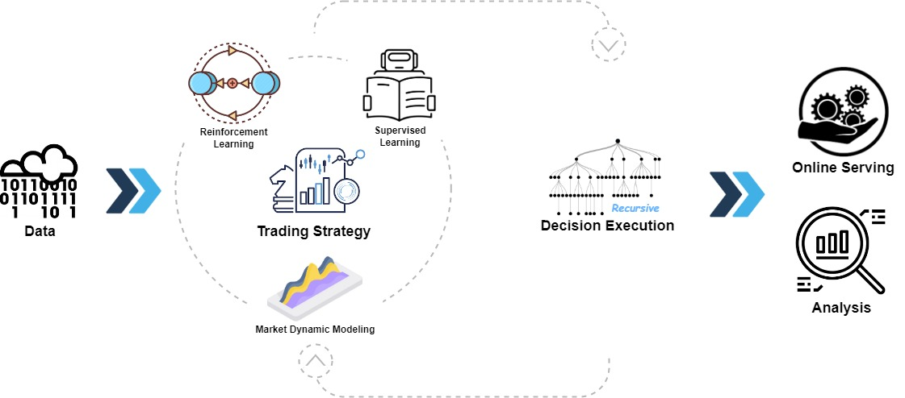

[](https://pypi.org/project/pyqlib/#files)
[](https://pypi.org/project/pyqlib/#files)
[](https://pypi.org/project/pyqlib/#history)
[](https://pypi.org/project/pyqlib/)
[](https://github.com/microsoft/qlib/actions)
[](https://qlib.readthedocs.io/en/latest/?badge=latest)
[](LICENSE)
[](https://gitter.im/Microsoft/qlib?utm_source=badge&utm_medium=badge&utm_campaign=pr-badge&utm_content=badge)

## :newspaper: **¿QUÉ HAY DE NUEVO !**! &nbsp;   :sparkling_heart** 

Características lanzadas recientemente

### Presentamos <a href="https://github.com/microsoft/RD-Agent"></a>: Agentes autónomos de evolución basada en LLM para I+D industrial impulsada por datos

Nos complace anunciar el lanzamiento de **RD-Agent**📢, una herramienta herramienta que soporta la minería automatizada de factores y la optimización de modelos en la I+D de inversión cuantitativa.

RD-Agent ya está disponible en [GitHub](https://github.com/microsoft/RD-Agent), ¡y te invitamos a dejar una ⭐!

Para obtener más información, visite nuestra [página de �acio♾️](https://rdagent.azurewebsites.net/). Aquí encontrará vídeos demostrativos en inglés y chino que le ayudarán a comprender mejor el escenario y el uso de RD-Agent.

Hemos preparado varios vídeos demostrativos para usted:
| Escenario | Vídeo demo (Inglés) | Vídeo demo (中文) |
| --                      | ------    | ------    |
| Minería de factores cuantitativos | [Enlace](https://rdagent.azurewebsites.net/factor_loop?lang=en) | [Enlace](https://rdagent.azurewebsites.net/factor_loop?lang=zh) |
| Minería de factores cuantitativos a partir de informes | [Enlace](https://rdagent.azurewebsites.net/report_factor?lang=en) | [Enlace](https://rdagent.azurewebsites.net/report_factor?lang=zh) |
| Optimización de modelos cuantitativos | [Enlace](https://rdagent.azurewebsites.net/model_loop?lang=en) | [Enlace](https://rdagent.azurewebsites.net/model_loop?lang=zh) |

- 📃**Artículo**: [R&D-Agent-Quant: A Multi-Agent Framework for Data-Centric Factors and Model Joint Optimization](https://arxiv.org/abs/2505.15155)
- 👾**Código**: https://github.com/microsoft/RD-Agent/
```BibTeX
@misc{li2025rdagentquant,
    title={R\&D-Agent-Quant: A Multi-Agent Framework for Data-Centric Factors and Model Joint Optimization},
    author={Yuante Li and Xu Yang and Xiao Yang and Minrui Xu and Xisen Wang and Weiqing Liu and Jiang Bian},
    year={2025},
    eprint={2505.15155},
    archivePrefix={arXiv},
    primaryClass={cs.AI}
}
```


***

| Característica | Estado |
| --                      | ------    |
| [R&D-Agent-Quant](https://arxiv.org/abs/2505.15155) Publicado | Aplicación de R&D-Agent a Qlib para operaciones cuantitativas | 
| BPQP para aprendizaje de extremo a extremo | 📈¡Próximamente!([En revisión](https://github.com/microsoft/qlib/pull/1863)) |
| 🔥Fábrica Cuantitativa automatizada impulsada por LLM🔥 | 🚀 Lanzado en [♾️RD-Agent](https://github.com/microsoft/RD-Agent) el 8 de agosto de 2024 |
| Modelos KRNN y Sandwich | :chart_with_upwards_trend: [Lanzado](https://github.com/microsoft/qlib/pull/1414/) el 26 de mayo de 2023 |
| Lanzamiento Qlib v0.9.0 | :octocat: [Lanzado](https://github.com/microsoft/qlib/releases/tag/v0.9.0) el 9 de diciembre de 2022 |
| Marco de aprendizaje RL | :hammer: :chart_with_upwards_trend: Lanzado el 10 de noviembre de 2022. [#1332](https://github.com/microsoft/qlib/pull/1332), [#1322](https://github.com/microsoft/qlib/pull/1322), [#1316](https://github.com/microsoft/qlib/pull/1316),[#1299](https://github.com/microsoft/qlib/pull/1299),[#1263](https://github.com/microsoft/qlib/pull/1263), [#1244](https://github.com/microsoft/qlib/pull/1244), [#1169](https://github.com/microsoft/qlib/pull/1169), [#1125](https://github.com/microsoft/qlib/pull/1125), [#1076](https://github.com/microsoft/qlib/pull/1076)|
| Modelos HIST e IGMTF | :chart_with_upwards_trend: [Lanzado](https://github.com/microsoft/qlib/pull/1040) el 10 de abril de 2022 |
| [tutorial con notebooks](https://github.com/microsoft/qlib/tree/main/examples/tutorial) de Qlib | 📖 [Lanzado](https://github.com/microsoft/qlib/pull/1037) el 7 de abril de 2022 | 
| Datos del índice Ibovespa | :rice: [Lanzado](https://github.com/microsoft/qlib/pull/990) el 6 de abril de 2022 |
| Base de datos Point-in-Time | :hammer: [Lanzado](https://github.com/microsoft/qlib/pull/343) el 10 de marzo de 2022 |
| Backend Arctic Provider y ejemplo de datos de libro de pedidosdenes | :hammer: [Lanzado](https://github.com/microsoft/qlib/pull/744) el 17 de enero de 2022 |
| Marco basado en Meta-Aprendizaje y DDG-DA  | :chart_with_upwards_trend:  :hammer: [Lanzado](https://github.com/microsoft/qlib/pull/743) el 10 de enero de 2022 | 
| Optimización de carteraportafolios basada en planificación | :hammer: [Lanzado](https://github.com/microsoft/qlib/pull/754) el 28 de diciembre de 2021 | 
| Lanzamiento Qlib v0.8.0 | :octocat: [Lanzado](https://github.com/microsoft/qlib/releases/tag/v0.8.0) el 8 de diciembre de 2021 |
| Modelo ADD | :chart_with_upwards_trend: [Lanzado](https://github.com/microsoft/qlib/pull/704) el 22 de noviembre de 2021 |
| Modelo ADARNN  | :chart_with_upwards_trend: [Lanzado](https://github.com/microsoft/qlib/pull/689) el 14 de noviembre de 2021 |
| Modelo TCN  | :chart_with_upwards_trend: [Lanzado](https://github.com/microsoft/qlib/pull/668) el 4 de noviembre de 2021 |
| Marco de toma anidado | :hammer: [Lanzado](https://github.com/microsoft/qlib/pull/438) el 1 de octubre de 2021. [Ejemplo](https://github.com/microsoft/qlib/blob/main/examples/nested_decision_execution/workflow.py) y [Documentación](https://qlib.readthedocs.io/en/latest/component/highfreq.html) |
| Adaptador de enrutamiento temporal (TRA) | :chart_with_upwards_trend: [Lanzado](https://github.com/microsoft/qlib/pull/531) el 30 de julio de 2021 |
| Transformer y Localformer | :chart_with_upwards_trend: [Lanzado](https://github.com/microsoft/qlib/pull/508) el 22 de julio de 2021 |
| Lanzamiento Qlib v0.7.0 | :octocat: [Lanzado](https://github.com/microsoft/qlib/releases/tag/v0.7.0) el 12 de julio de 2021 |
| Modelo TCTS | :chart_with_upwards_trend: [Lanzado](https://github.com/microsoft/qlib/pull/491) el 1 de julio de 2021 |
| Servicio en línea y actualización automática de modelos | :hammer:  [Lanzado](https://github.com/microsoft/qlib/pull/290) el 17 de mayo de 2021 | 
| Modelo DoubleEnsemble | :chart_with_upwards_trend: [Lanzado](https://github.com/microsoft/qlib/pull/286) el 2 de marzo de 2021 | 
| Ejemplo de procesamiento de datos de alta frecuencia | :hammer: [Lanzado](https://github.com/microsoft/qlib/pull/257) el 5 de febrero de 2021  |
| Ejemplo de operaciones de alta frecuencia | :chart_with_upwards_trend: [Parte del código liberado](https://github.com/microsoft/qlib/pull/227) el 28 de enero de 2021  | 
| Datos de alta frecuencia (1 min) | :rice: [Lanzado](https://github.com/microsoft/qlib/pull/221) el 27 de enero de 2021 |
| Modelo Tabnet | :chart_with_upwards_trend: [Lanzado](https://github.com/microsoft/qlib/pull/205) el 22 de enero de 2021 |

Las características lanzadas antes de 2021 no se incluyen aquí.

<p align="center">
  
</p>

Qlib es una plataforma de inversión cuantitativa de código abierto orientada a la IA, diseñada para desbloquear el potencial, impulsar la investigación y generar valor utilizando tecnologías de IA en la inversión cuantitativa, desde la exploración de ideas hasta la implementación en producción. Qlib soporta diversos paradigmas de modelado de aprendizaje automático, incluido aprendizaje supervisado, modelado de la dinámica del mercado y aprendizaje por refuerzo.

Un número creciente de trabajos/papers de investigación cuantitativa de SOTA en diversos paradigmas se están publicando en Qlib para resolver colaborativamente los desafíos clave en la inversión cuantitativa. Por ejemplo, 1) usar aprendizaje supervisado para descubrirminar patrones complejos no lineales del mercado a partir de datos financieros ricos y heterogéneos, 2) modelar la naturaleza dinámica del mercado financiero utilizando tecnología de adaptaciónderiva de conceptos adaptativa, y 3) usar aprendizaje por refuerzo para modelar decisiones de inversión continuas y ayudar a los inversores a optimizar sus estrategias de trading.

Contiene el pipeline completo de ML para procesamiento de datos, entrenamiento de modelos, backtesting y evaluación; y cubre toda la cadena de la inversión cuantitativa: búsqueda de alfa, modelado de riesgo, optimización de portafolios y ejecución de órdenes. Para más detalles, consulte nuestro artículo ["Qlib: An AI-oriented Quantitative Investment Platform"](https://arxiv.org/abs/2009.11189).


<table>
  <tbody>
    <tr>
      <th>Frameworks, Tutoriales, Datos y DevOps</th>
      <th>Principales Desaf y soluciones en la investigación cuantitativa</th>
    </tr>
    <tr>
      <td>
        <li><a href="#plans"><strong>Planes</strong></a></li>
        <li><a href="#framework-of-qlib">Arquitectura de Qlib</a></li>
        <li><a href="#quick-start">Inicio rápido</a></li>
          <ul dir="auto">
            <li type="circle"><a href="#installation">Instalación</a> </li>
            <li type="circle"><a href="#data-preparation">Preparación de datos</a></li>
            <li type="circle"><a href="#auto-quant-research-workflow">Flujo de trabajo de investigación cuantitativa automatizado</a></li>
            <li type="circle"><a href="#building-customized-quant-research-workflow-by-code">Construcción de un flujo de trabajo de investigación cuantitativa personalizado por código</a></li></ul>
        <li><a href="#quant-dataset-zoo"><strong>Catálogo de conjuntos de datos cuantitativos</strong></a></li>
        <li><a href="#learning-framework">Marco de aprendizaje</a></li>
        <li><a href="#more-about-qlib">Más sobre Qlib</a></li>
        <li><a href="#offline-mode-and-online-mode">Modo sin conexión y modo en línea</a>
        <ul>
          <li type="circle"><a href="#performance-of-qlib-data-server">Rendimiento del servidor de datos de Qlib</a></li></ul>
        <li><a href="#related-reports">Informes relacionados</a></li>
        <li><a href="#contact-us">Contáctenos</a></li>
        <li><a href="#contributing">Contribuciones</a></li>
      </td>
      <td valign="baseline">
        <li><a href="#main-challenges--solutions-in-quant-research">Principales desafíos y soluciones en la investigación cuantitativa</a>
          <ul>
            <li type="circle"><a href="#forecasting-finding-valuable-signalspatterns">Pronóstico: Encontrar señales/patrones valiosos</a>
              <ul>
                <li type="disc"><a href="#quant-model-paper-zoo"><strong>Catálogo de modelos cuantitativos (Paper)</strong></a>
                  <ul>
                    <li type="circle"><a href="#run-a-single-model">Ejecutar un solo modelo</a></li>
                    <li type="circle"><a href="#run-multiple-models">Ejecutar múltiples modelos</a></li>
                  </ul>
                </li>
              </ul>
            </li>
          <li type="circle"><a href="#adapting-to-market-dynamics">Adaptación a la dinámica del mercado</a></li>
          <li type="circle"><a href="#reinforcement-learning-modeling-continuous-decisions">Aprendizaje por refuerzo: modelado de decisiones continuas</a></li>
          </ul>
        </li>
      </td>
    </tr>
  </tbody>
</table>

# Planes
Nuevas características en desarrollo (ordenadas por tiempo estimadosado de lanzamiento estimado).
Sus comentarios sobre las características son muy importantes.
<!-- | Feature                        | Status      | -->
<!-- | --                      | ------    | -->

# Arquitectura de Qlib

<div style="align: center">

</div>

La arquitectura de alto nivel de Qlib se puede ver arriba (los usuarios pueden encontrar la [arquitectura detallada](https://qlib.readthedocs.io/en/latest/introduction/introduction.html#framework) del diseño de Qlib al entrar en los detalles).
Los componentes están diseñados como módulos acoplados de forma laxa, y cada componente puede usarse de forma independientestandalone.

Qlib proporciona una infraestructura sólidarobusta para apoyar la investigación cuantitativa. [Los datos](https://qlib.readthedocs.io/en/latest/component/data.html) siempre son una parte importante.
Se ha diseñado un marco de aprendizaje ndo para soportar diversos paradigmas de aprendizaje (por ejemplo, [aprendizaje por refuerzo](https://qlib.readthedocs.io/en/latest/component/rl.html), [aprendizaje supervisado](https://qlib.readthedocs.io/en/latest/component/workflow.html#model-section)) y patrones a diferentes niveles (por ejemplo, [modelado de la dinámica del mercado](https://qlib.readthedocs.io/en/latest/component/meta.html)).
Al modelar el mercado, las [estrategias de trading](https://qlib.readthedocs.io/en/latest/component/strategy.html) generarán decisiones de trading que se ejecutarán. Múltiples estrategias de trading y ejecutores en diferentes niveles o granularidades pueden [anidarse para ser optimizados y ejecutados juntos](https://qlib.readthedocs.io/en/latest/component/highfreq.html).
Finalmente, se proporcionará un [análisis](https://qlib.readthedocs.io/en/latest/component/report.html) completo y el modelo puede ser [servido en línea](https://qlib.readthedocs.io/en/latest/component/online.html) a bajo costo.


# Inicio rápido

Esta guía de inicio rápido intenta demostrar
1. Que es muy fácil construir un flujo de trabajo completo de investigación cuantitativa y probar sus ideas con _Qlib_.
2. Que aunque con *datos públicos* y *modelos simples*, las tecnologías de aprendizaje automático **funcionan muy bien** en la inversión cuantitativa práctica.

Aquí hay una **[demostración](https://terminalizer.com/view/3f24561a4470)** que muestra cómo instalar ``Qlib``, y ejecutar LightGBM con ``qrun``. **PeroPero**, asegúrese de haber preparado los datos siguiendo la [instrucción](#data-preparation).


## Instalación

Esta tabla muestra la versión de Python soportada por `Qlib`:
|               | instalar con pip      | instalar desde código fuente  |        gráficográficos        |
| ------------- |:---------------------:|:--------------------:|:------------------:|
| Python 3.8    | :heavy_check_mark:    | :heavy_check_mark:   | :heavy_check_mark: |
| Python 3.9    | :heavy_check_mark:    | :heavy_check_mark:   | :heavy_check_mark: |
| Python 3.10   | :heavy_check_mark:    | :heavy_check_mark:   | :heavy_check_mark: |
| Python 3.11   | :heavy_check_mark:    | :heavy_check_mark:   | :heavy_check_mark: |
| Python 3.12   | :heavy_check_mark:    | :heavy_check_mark:   | :heavy_check_mark: |

**Nota**: 
1. Se recomiendasugiere **Conda** para gestionar su entorno de Python. En algunos casos, usar Python fuera de un entorno `conda` puede resultar en la falta de archivos de encabezedecabecera, lo que causa el fallo de instalación de ciertos paquetes.
2. Tenga en cuenta que instalarinstalar cython en Python 3.6 generará algunos errores al instalar ``Qlib`` desde el código fuente. Si los usuarios usan Python 3.6 en sus máquinas, se recomienda *actualizar* Python a la versión 3.8 o superior, o usar el Python de `conda` para instalar ``Qlib`` desde el código fuente.

### Instalar con pip
Los usuarios pueden instalar ``Qlib`` fácilmente con pip según el siguiente comando.

```bash
  pip install pyqlib
```

**Nota**: pip instalará la última versión estable de qlib. Sin embargo, la rama principal de qlib está en desarrollo activo. Si desea probar los últimos scripts o funciones en la rama principal, instale qlib con los métodosa continuación.

### Instalar desde código fuente
Además, los usuarios pueden instalar la última versión de desarrollo ``Qlib`` desde el código fuente los pasosa continuación:

* Antes de instalar ``Qlib`` desde el código fuente, los usuarios deben instalar algunas dependencias:

  ```bash
  pip install numpy
  pip install --upgrade cython
  ```

* Clone el repositorio e instale ``Qlib`` de la siguiente manera.
    ```bash
    git clone https://github.com/microsoft/qlib.git && cd qlib
    pip install .  # Se recomienda `pip install -e .[dev]` para desarrollo. consulte los detalles en docs/developer/code_standard_and_dev_guide.rst
    ```

**Consejos**: Si falla la instalación de `Qlib` o la ejecución de los ejemplos en su entorno, comparar sus pasos con el [flujo de trabajo de CI](.github/workflows/test_qlib_from_source.yml) puede ayudarle a encontrar el problema.

**Consejos para Mac**: Si está usando un Mac con M1, es posible que enfrenten problemas al construiruildar el wheel para LightGBM, debido a la falta de dependencias de OpenMP. Para resolver el problema, instale openmp primero con ``brew install libomp`` y luego ejecute ``pip install .`` para construirlo con éxito. 

## Preparación de datos
❗ Debido a políticas de seguridad de datos más estrictas. El conjunto de datos oficial está deshabilitado temporalmente. Puede probar [esta fuente de datos](https://github.com/chenditc/investment_data/releases) contribuida por la comunidad.
Aquí hay un ejemplo para descargar los datos más recientes.
```bash
wget https://github.com/chenditc/investment_data/releases/latest/download/qlib_bin.tar.gz
mkdir -p ~/.qlib/qlib_data/cn_data
tar -zxvf qlib_bin.tar.gz -C ~/.qlib/qlib_data/cn_data --strip-components=1
rm -f qlib_bin.tar.gz
```

El conjunto de datos oficial a continuación se reanudará en el próximo futuro.


----

Cargar y preparar datos ejecutando el siguiente código:

### Obtener con el módulo
  ```bash
  # obtener datos de 1d
  python -m qlib.cli.data qlib_data --target_dir ~/.qlib/qlib_data/cn_data --region cn

  # obtener datos de 1min
  python -m qlib.cli.data qlib_data --target_dir ~/.qlib/qlib_data/cn_data_1min --region cn --interval 1min

  ```

### Obtener desde código fuente

  ```bash
  # obtener datos de 1d
  python scripts/get_data.py qlib_data --target_dir ~/.qlib/qlib_data/cn_data --region cn

  # obtener datos de 1min
  python scripts/get_data.py qlib_data --target_dir ~/.qlib/qlib_data/cn_data_1min --region cn --interval 1min

  ```

Este conjunto de datos fue creado por datos públicos recopilollectados por [scripts de crawler](scripts/data_collector/), que han sido publicadoseleasereleased en el mismo repositorio.
Los usuarios podrían crear el mismo conjunto de datos con él. [Descripción del conjunto de datos](https://github.com/microsoft/qlib/tree/main/scripts/data_collector#description-of-dataset)

*Por favor preste **ATENCIÓN** a que los datos son recogados de [Yahoo Finance](https://finance.yahoo.com/lookup), y los datos podrían no ser perfectos.
Recomendamos a los usuarios que preparen sus propios datos si tienen un conjunto de datos de alta calidad. Para más información, los usuarios pueden consultar la [documentación relacionada](https://qlib.readthedocs.io/en/latest/component/data.html#converting-csv-format-into-qlib-format)*.

### Actualización automática de datos de frecuencia diaria (desde Yahoo Finance)
  > Este paso es *Opcional* si los usuarios solo quieren probar sus modelos y estrategias en datos históricos.
  > 
  > Se recomienda que los usuarios actualicen los datos manualmente una vez (--trading_date 2021-05-25) y luego lo configuren para actualizar automáticamente.
  >
  > **NOTA**: Los usuarios no pueden actualizar incrementalmente los datos basándose en los datos fuera de línea proporcionados por Qlib(algunos campos se eliminaron para reducir el tamaño de los datos). Los usuarios deben usar el [colector de yahoo](https://github.com/microsoft/qlib/tree/main/scripts/data_collector/yahoo#automatic-update-of-daily-frequency-datafrom-yahoo-finance) para descargar datos de Yahoo desde cero y luego actualizarlos incrementalmente.
  > 
  > Para más información, consulte: [colector de yahoo](https://github.com/microsoft/qlib/tree/main/scripts/data_collector/yahoo#automatic-update-of-daily-frequency-datafrom-yahoo-finance)

  * Actualización automática de datos al directorio "qlib" cada día de negociación (Linux)
      * usar *crontab*: `crontab -e`
      * configurar tareas programadas:

        ```
        * * * * 1-5 python <ruta del script> update_data_to_bin --qlib_data_1d_dir <directorio de datos del usuario>
        ```
        * **ruta del script**: *scripts/data_collector/yahoo/collector.py*

  * Actualización manual de datos
      ```
      python scripts/data_collector/yahoo/collector.py update_data_to_bin --qlib_data_1d_dir <directorio de datos del usuario> --trading_date <fecha de inicio> --end_date <fecha de fin>
      ```
      * *trading_date*: inicio del día de negociación
      * *end_date*: final del día de negociación (no incluido)

### Verificar la salud de los datos
  * Proporcionamos un script para verificar la salud de los datos, puede ejecutar los siguientes comandos para verificar si los datos están sanos o no.
    ```
    python scripts/check_data_health.py check_data --qlib_dir ~/.qlib/qlib_data/cn_data
    ```
  * Por supuesto, también puede agregar algunos parámetros para ajustar los resultados de la prueba, como este.
    ```
    python scripts/check_data_health.py check_data --qlib_dir ~/.qlib/qlib_data/cn_data --missing_data_num 30055 --large_step_threshold_volume 94485 --large_step_threshold_price 20
    ```
  * Si desea más información sobre `check_data_health`, consulte la [documentación](https://qlib.readthedocs.io/en/latest/component/data.html#checking-the-health-of-the-data).

<!-- 
- Ejecute el código de inicialización y obtenga datos de acciones:

  ```python
  import qlib
  from qlib.data import D
  from qlib.constant import REG_CN

  # Inicialización
  mount_path = "~/.qlib/qlib_data/cn_data"  # target_dir
  qlib.init(mount_path=mount_path, region=REG_CN)

  # Obtener datos de acciones por Qlib
  # Cargar calendario de negociación con el rango de tiempo y frecuencia dados
  print(D.calendar(start_time='2010-01-01', end_time='2017-12-31', freq='day')[:2])

  # Analizar un nombre de mercado dado en una configuración de stockpool
  instruments = D.instruments('csi500')
  print(D.list_instruments(instruments=instruments, start_time='2010-01-01', end_time='2017-12-31', as_list=True)[:6])

  # Cargar características de ciertos instrumentos en el rango de tiempo dado
  instruments = ['SH600000']
  fields = ['$close', '$volume', 'Ref($close, 1)', 'Mean($close, 3)', '$high-$low']
  print(D.features(instruments, fields, start_time='2010-01-01', end_time='2017-12-31', freq='day').head())
  ```
 -->

## Imágenes de Docker
1. Obtener una imagen de docker desde un repositorio de docker hub
    ```bash
    docker pull pyqlib/qlib_image_stable:stable
    ```
2. Iniciar un nuevo contenedor de Docker
    ```bash
    docker run -it --name <nombre del contenedor> -v <directorio local montado>:/app pyqlib/qlib_image_stable:stable
    ```
3. En este punto, está en el entorno docker y puede ejecutar los scripts de qlib. Un ejemplo:
    ```bash
    >>> python scripts/get_data.py qlib_data --name qlib_data_simple --target_dir ~/.qlib/qlib_data/cn_data --interval 1d --region cn
    >>> python qlib/cli/run.py examples/benchmarks/LightGBM/workflow_config_lightgbm_Alpha158.yaml
    ```
4. Salir del contenedor
    ```bash
    >>> exit
    ```
5. Reiniciar el contenedor
    ```bash
    docker start -i -a <nombre del contenedor>
    ```
6. Detener el contenedor
    ```bash
    docker stop <nombre del contenedor>
    ```
7. Eliminar el contenedor
    ```bash
    docker rm <nombre del contenedor>
    ```
8. Si desea obtener más información, consulte la [documentación](https://qlib.readthedocs.io/en/latest/developer/how_to_build_image.html).

## Flujo de trabajo de investigación cuantitativa automatizada
Qlib proporciona una herramienta llamada `qrun` para ejecutar todo el flujo de trabajo automáticamente (incluida la construcción del conjunto de datos, entrenamiento de modelos, backtesting y evaluación). Puede iniciar un flujo de trabajo de investigación cuantitativa automatizado y tener un análisis de informes gráficos según los siguientes pasos: 

1. Flujo de trabajo de investigación cuantitativa: Ejecute `qrun` con la configuración de flujo de trabajo de lightgbm ([workflow_config_lightgbm_Alpha158.yaml](examples/benchmarks/LightGBM/workflow_config_lightgbm_Alpha158.yaml) como se muestra a continuación.
    ```bash
      cd examples  # Evite ejecutar el programa bajo el directorio que contiene `qlib`
      qrun benchmarks/LightGBM/workflow_config_lightgbm_Alpha158.yaml
    ```
    Si los usuarios quierenquieren usar `qrun` bajo el modo de depuración, use el siguiente comando:
    ```bash
    python -m pdb qlib/cli/run.py examples/benchmarks/LightGBM/workflow_config_lightgbm_Alpha158.yaml
    ```
    El resultado de `qrun` es el siguiente, consulte [docs](https://qlib.readthedocs.io/en/latest/component/strategy.html#result) para más explicaciones sobre el resultado. 

    ```bash

    'Los siguientes son resultados de análisis del exceso de retorno sin costososto.'
                           risk
    mean               0.000708
    std                0.005626
    annualized_return  0.178316
    information_ratio  1.996555
    max_drawdown      -0.081806
    'Los siguientes son resultados de análisis del exceso de retorno con uesto.'
                           risk
    mean               0.000512
    std                0.005626
    annualized_return  0.128982
    information_ratio  1.444287
    max_drawdown      -0.091078
    ```
    Aquí están los documentos detallados para `qrun` y [flujo de trabajo](https://qlib.readthedocs.io/en/latest/component/workflow.html).

2. Análisis de informes gráficos: Primero, ejecute `python -m pip install .[analysis]` para instalar las dependencias requeridas. Luego ejecute `examples/workflow_by_code.ipynb` con `jupyter notebook` para obtener informes gráficos. 
    - Análisis de la señal de pronóstico (predicción del modelo)
      - Rendturno acumativo de los grupos
      
      - Distribución del retorno
      
      - Coeficiente de Informaciónnformación (IC)
      
      
      
      - Autocorrelación de la señal de pronóstico (predicción del modelo)
      

    - Análisis del portafolio
      - Retorno del backtesting
      
      <!-- 
      - IC de puntuación
      
      - Retorno acumulativo
      
      - Análisis de riesgo
      
      - Clasetado por rango
      
      -->
   - [Explicación](https://qlib.readthedocs.io/en/latest/component/report.html) de los resultados anteriores

## Construcción de un flujo de trabajo de investigación cuantitativa personalizado por código
El flujo de trabajo automático puede no adecudaptar al flujo de trabajo de investigación de todos los investigadores cuantitativos. Para soportar un flujo de trabajo de investigación cuantitativa flexible, Qlib también proporciona una interfaz modularizada para permitir a los investigadores construir su propio flujo de trabajo por código. [Aquí](examples/workflow_by_code.ipynb) hay un ejemplo de flujo de trabajo de investigación cuantitativa personalizado por código.

# Principales desafíos y soluciones en la investigación cuantitativa
La inversión cuantitativa es un escenario muy único con muchos desafíos clave por resolver.
Actualmente, Qlib proporciona algunas soluciones para varios de ellos.

## Pronóstico: Encontrar señales/patrones valiosos
Un pronóstico preciso de la tendencia de los precios de las acciones es una parte muy importante para construir portafolios rentables.
Sin embargo, la gran cantidad de datos en diversos formatos en el mercado financiero hace que sea un desafío construir modelos de pronóstico.

Un número creciente de trabajos/papers de investigación cuantitativa de SOTA, enfocque se centran en construir modelos de pronóstico para minar señales/patrones valiosos en datos financieros complejos, se publican en `Qlib`


### [Catálogo de modelos cuantitativos (Paper)](examples/benchmarks)

Aquí hay una lista de modelos construidos en `Qlib`.
- [GBDT basado en XGBoost (Tianqi Chen, et al. KDD 2016)](examples/benchmarks/XGBoost/)
- [GBDT basado en LightGBM (Guolin Ke, et al. NIPS 2017)](examples/benchmarks/LightGBM/)
- [GBDT basado en Catboost (Liudmila Prokhorenkova, et al. NIPS 2018)](examples/benchmarks/CatBoost/)
- [MLP basado en pytorch](examples/benchmarks/MLP/)
- [LSTM basado en pytorch (Sepp Hochreiter, et al. Neural computation 1997)](examples/benchmarks/LSTM/)
- [GRU basado en pytorch (Kyunghyun Cho, et al. 2014)](examples/benchmarks/GRU/)
- [ALSTM basado en pytorch (Yao Qin, et al. IJCAI 2017)](examples/benchmarks/ALSTM)
- [GATs basado en pytorch (Petar Velickovic, et al. 2017)](examples/benchmarks/GATs/)
- [SFM basado en pytorch (Liheng Zhang, et al. KDD 2017)](examples/benchmarks/SFM/)
- [TFT basado en tensorflow (Bryan Lim, et al. International Journal of Forecasting 2019)](examples/benchmarks/TFT/)
- [TabNet basado en pytorch (Sercan O. Arik, et al. AAAI 2019)](examples/benchmarks/TabNet/)
- [DoubleEnsemble basado en LightGBM (Chuheng Zhang, et al. ICDM 2020)](examples/benchmarks/DoubleEnsemble/)
- [TCTS basado en pytorch (Xueqing Wu, et al. ICML 2021)](examples/benchmarks/TCTS/)
- [Transformer basado en pytorch (Ashish Vaswani, et al. NeurIPS 2017)](examples/benchmarks/Transformer/)
- [Localformer basado en pytorch (Juyong Jiang, et al.)](examples/benchmarks/Localformer/)
- [TRA basado en pytorch (Hengxu, Dong, et al. KDD 2021)](examples/benchmarks/TRA/)
- [TCN basado en pytorch (Shaojie Bai, et al. 2018)](examples/benchmarks/TCN/)
- [ADARNN basado en pytorch (YunTao Du, et al. 2021)](examples/benchmarks/ADARNN/)
- [ADD basado en pytorch (Hongshun Tang, et al.2020)](examples/benchmarks/ADD/)
- [IGMTF basado en pytorch (Wentao Xu, et al.2021)](examples/benchmarks/IGMTF/)
- [HIST basado en pytorch (Wentao Xu, et al.2021)](examples/benchmarks/HIST/)
- [KRNN basado en pytorch](examples/benchmarks/KRNN/)
- [Sandwich basado en pytorch](examples/benchmarks/Sandwich/)

¡Se aceptan activamente las PRs de nuevos modelos cuantitativos!

El rendimiento de cada modelo en los conjuntos de datos `Alpha158` y `Alpha360` se puede encontrar [aquí](examples/benchmarks/README.md).

### Ejecutar un solo modelo
Todos los modelos anterioresa arriba son ejecutables con ``Qlib``. Los usuarios pueden encontrar los archivos de configuración que proporcionamos y algunos detalles sobre el modelo a través de la carpeta [benchmarks](examples/benchmarks). Más información se puede obtener en los archivos de los modelos listados arriba.

`Qlib` proporciona tres maneras diferentes para ejecutar un solo modelo, los usuarios pueden elegir la que mejor se adap a sus casos:
- Los usuarios pueden usar la herramienta `qrun` mencionada anteriormente para ejecutar el flujo de trabajo de un modelo desde un archivo de configuración.
- Los usuarios pueden crear un script `workflow_by_code` en Python basado en el [uno](examples/workflow_by_code.py) listado en la carpeta `examples`.

- Los usuarios pueden usar el script [`run_all_model.py`](examples/run_all_model.py) listado en la carpeta `examples` para ejecutar un modelo. Aquí hay un ejemplo del comando shell específico a usar: `python run_all_model.py run --models=lightgbm`, donde los argumentos `--models` pueden tomar cualquier número de modelos listados anteriormente (los modelos disponibles se pueden encontrar en [benchmarks](examples/benchmarks/)). Para más casos de uso, consulte los [docstrings](examples/run_all_model.py) del archivo.
    - **NOTA**: Cada línea base tiene diferentes dependencias de entorno, asegúrese de que su versión de Python se alinee con los requisitos (por ejemplo, TFT solo soporta Python 3.6~3.7 debido a la limitación de `tensorflow==1.15.0`)

### Ejecutar múltiples modelos
`Qlib` también proporciona un script [`run_all_model.py`](examples/run_all_model.py) que puede ejecutar múltiples modelos durante varias iteraciones. (**Nota**: el script solo soporta *Linux* por ahora. OtrosOtras SO se soportarán en el futuro. Además, no soporta ejecutar el mismo modelo en paralelo múltiples veces, lo cual se corregirá en el futuro desarrollo también.)

El script creará un entorno virtual único para cada modelo, y eliminará los entornos después del entrenamiento. Por lo tanto, solo se generarán y almacenarán los resultados del experimento como `IC` y resultados de `backtest`.

Aquí hay un ejemplo de ejecutar todos los modelos durante 10 iteraciones:
```python
python run_all_model.py run 10
```

También proporciona la API para ejecutar modelos específicos a la vez. Para más casos de uso, consulte los [docstrings](examples/run_all_model.py) del archivo. 

### Cambio importante
En `pandas`, `group_key` es uno de los parámetros del método `groupby`. De la versión 1.5 a la 2.0 de `pandas`, el valor por defecto de `group_key` cambió de `no default` a `True`, lo que hará que qlib informe un error durante la operación. Por lo tanto, configuramos `group_key=False`, pero no garantizamos que algunos programas se ejecuten correctamente, incluyendo:
* qlib\examples\rl_order_execution\scripts\gen_training_orders.py
* qlib\examples\benchmarks\TRA\src\dataset.MTSDatasetH.py
* qlib\examples\benchmarks\TFT\tft.py


## [Adaptación a la dinámica del mercado](examples/benchmarks_dynamic)

Debido a la naturaleza no estacionaria del entorno del mercado financiero, la distribución de datos puede cambiar en diferentes períodos, lo que hace que el rendimiento de los modelos construidos sobre datos de entrenamiento decaiga en los datos de prueba futuros.
Por lo tanto, adaptar los modelos de pronóstico/estrategias a la dinámica del mercado es muy importante para el rendimiento de los modelos/estrategias.

Aquí hay una lista de soluciones construidas en `Qlib`.
- [Reentrenamiento por rodillos](examples/benchmarks_dynamic/baseline/)
- [DDG-DA en pytorch (Wendi, et al. AAAI 2022)](examples/benchmarks_dynamic/DDG-DA/)

## aje por refuerzo: modelado de decisiones continuas
Qlib ahora soporta aprendizaje por refuerzo, una característica diseñada para modelar decisiones de inversión continuas. Esta funcionalidad asiste a los inversores en la optimización de sus estrategias de trading aprendiendo de las interacciones con el entorno para maximizar alguna noción de uesto acumativo.

Aquí hay una lista de soluciones construidas en `Qlib` categorizadas por escenarios.

### [RL para ejecución de órdenes](examples/rl_order_execution)
[Aquí](https://qlib.readthedocs.io/en/latest/component/rl/overall.html#order-execution) está la introducción de este escenario.  Todos los métodos que se comparán se comparán [aquí](examples/rl_order_execution).
- [TWAP](examples/rl_order_execution/exp_configs/backtest_twap.yml)
- [PPO: "An End-to-End Optimal Trade Execution Framework based on Proximal Policy Optimization", IJCAL 2020](examples/rl_order_execution/exp_configs/backtest_ppo.yml)
- [OPDS: "Universal Trading for Order Execution with Oracle Policy Distillation", AAAI 2021](examples/rl_order_execution/exp_configs/backtest_opds.yml)

# Catálogo de conjuntos de datos cuantitativos
El conjunto de datos juega un rol muy importante en la inversión cuantitativa. Aquí hay una lista de los conjuntos de datos construidos en `Qlib`:

| Conjunto de datos                                    | Mercado EE.UU. | Mercado China |
| --                                         | --        | --           |
| [Alpha360](./qlib/contrib/data/handler.py) |  √        |  √           |
| [Alpha158](./qlib/contrib/data/handler.py) |  √        |  √           |

[Aquí](https://qlib.readthedocs.io/en/latest/advanced/alpha.html) hay un tutorial para construir conjuntos de datos con `Qlib`.
¡Se aceptan activamente las PRs para construir nuevos conjuntos de datos cuantitativos!


# Marco de aprendizaje
Qlib es altamente personalizable y muchos de sus componentes son aprendibles.
Los componentes aprendibles son instancias de `Forecast Model` y `Trading Agent`. Son aprendidos basados en la capa `Learning Framework` y luego aplicados a múltiples escenarios en la capa `Workflow`.
El marco de aprendizaje aprovecha también la capa `Workflow` (por ejemplo, compartir `Information Extractor`, crear entornos basados en `Execution Env`).

Basados en paradigmas de aprendizaje, se pueden categorizar en aprendizaje por refuerzo y aprendizaje supervisado.
- Para aprendizaje supervisado, la documentación detallada se puede encontrar [aquí](https://qlib.readthedocs.io/en/latest/component/model.html).
- Para aprendizaje por refuerzo, la documentación detallada se puede encontrar [aquí](https://qlib.readthedocs.io/en/latest/component/rl.html). El marco de aprendizaje RL de Qlib aprovecha `Execution Env` en la capa `Workflow` para crear entornos. Vale la pena notar que `NestedExecutor` también es soportado. Esto permite a los usuarios optimizar diferentes niveles de estrategias/modelos/agentes juntos (por ejemplo, optimizar una estrategia de ejecución de órdenes para una estrategia específicapecifica de gestión de portafolios).


# Más sobre Qlib
Si desea echarechar un rápidoazo a los componentes más frecuentemente usados de qlib, puede intentar los notebooks [aquí](examples/tutorial/).

La documentación detallada está organizada en [docs](docs/).
Se requiere [Sphinx](http://www.sphinx-doc.org) y el tema readthedocs para construir la documentación en formatos html. 
```bash
cd docs/
conda install sphinx sphinx_rtd_theme -y
# De lo contrario, puede instalarlos con pip
# pip install sphinx sphinx_rtd_theme
make html
```
También puede ver la [documentación más reciente](http://qlib.readthedocs.io/) en línea directamente.

Qlib está en desarrollo activo y continuo. Nuestro plan está en la hoja de ruta, que se gestiona como un [proyecto de github](https://github.com/microsoft/qlib/projects/1).


# Modo sin conexión y modo en línea
El servidor de datos de Qlib se puede desple como modo `Offline` o modo `Online`. El modo por defecto es el modo sin conexión.

Bajo el modo `Offline`, los datos se implementarán localmente. 

Bajo el modo `Online`, los datos se implementarán como un servicio de datos compartido. Los datos y su caché serán compartidos por todos los clientes. Se espera que el rendimiento de la recuperación de datos mejore debido a una mayor tasa de aciertos en caché. También consumirá menos espacio en disco. La documentación del modo en línea se puede encontrar en [Qlib-Server](https://qlib-server.readthedocs.io/). El modo en línea se puede implementargar automáticamente con [scripts basados en Azure CLI](https://qlib-server.readthedocs.io/en/latest/build.html#one-click-deployment-in-azure). El código fuente del servidor de datos en línea se puede encontrar en el [repositorio Qlib-Server](https://github.com/microsoft/qlib-server).

## Rendimiento del servidor de datos de Qlib
El rendimiento del procesamiento de datos es importante para métodos impulsados por datos como las tecnologías IA. Como plataforma orientada a la IA, Qlib proporciona una solución para almacenamientotore de datos y procesamiento de datos. Para demostrar el rendimiento del servidor de datos de Qlib, lo comparamos con otras soluciones de orte de datos. 

Evaluamos el rendimiento de varias soluciones de orte finalizando la misma tarea,
que crea un conjunto de datos (14 características/factores) a partir de los datos diarios OHLCV básicos de un mercado de acciones (800 acciones cada día desde 2007 hasta 2020). La tarea involuc consultas de datos y procesamiento.

|                         | HDF5      | MySQL     | MongoDB   | InfluxDB  | Qlib -E -D  | Qlib +E -D   | Qlib +E +D  |
| --                      | ------    | ------    | --------  | --------- | ----------- | ------------ | ----------- |
| Total (1CPU) (segundos)  | 184.4±3.7 | 365.3±7.5 | 253.6±6.7 | 368.2±3.6 | 147.0±8.8   | 47.6±1.0     | **7.4±0.3** |
| Total (64CPU) (segundos) |           |           |           |           | 8.8±0.6     | **4.2±0.2**  |             |
* `+(-)E` indica con (sin) `ExpressionCache`
* `+(-)D` indica con (sin) `DatasetCache`

La mayoría de las bases de datos de propósito genérico tardan demasiado tiempo en cargar datos. Tras de examinar la implementación subyacente, encontramos que los datos pasan a través de demasiadas capas de interfaces y transformaciones de formato innecesarias en las soluciones de bases de datos de propósito genérico.
Dichos sobrecostosodos ralentizan enormemente el proceso de carga de datos.
Los datos de Qlib se ortalan en un formato compacto, que es eficiente para combinarse en arreglos para el cálculo científico.

# Informes relacionados
- [Guide To Qlib: Microsoft’s AI Investment Platform](https://analyticsindiamag.com/qlib/)
- [微软也搞AI量化平台？还是开源的！](https://mp.weixin.qq.com/s/47bP5YwxfTp2uTHjUBzJQQ)
- [微矿Qlib：业内首个AI量化投资开源平台](https://mp.weixin.qq.com/s/vsJv7lsgjEi-ALYUz4CvtQ)

# Contáctenos
- Si tiene algún problema, cree un [issue aquí](https://github.com/microsoft/qlib/issues/new/choose) o envíe mensajes en [gitter](https://gitter.im/Microsoft/qlib).
- Si desea contribuir contribuciones a `Qlib`, por favor [cree pull requests](https://github.com/microsoft/qlib/compare). 
- Para otras razones, puede contactarnos por correo electrónico([qlib@microsoft.com](mailto:qlib@microsoft.com)).
  - ¡Estamos contratando nuevos miembros (tanto FTEs como pasantes), ¡sus CVs son bienvenidos!

Únase a los grupos de discusión IM:
|[Gitter](https://gitter.im/Microsoft/qlib)|
|----|
||

# Contribuciones
Agradecemos todas las contribuciones y agrado a todos los colaboradores!
<a href="https://github.com/microsoft/qlib/graphs/contributors"></a>

Antes de lanzar Qlib como un proyecto de código abierto en Github en sep 2020, Qlib era un proyecto interno en nuestro grupo. Lamentablemente, el historial de commits interno no se conserva. Muchos miembros de nuestro grupo también han aporto aportortado significativamente a Qlib, lo que incluye a Ruihua Wang, Yinda Zhang, Haisu Yu, Shuyu Wang, Bochen Pang, y [Dong Zhou](https://github.com/evanzd/evanzd). Especialmente gracias a [Dong Zhou](https://github.com/evanzd/evanzd) debido a su versión inicial de Qlib.

##,

Este proyecto da la bienvenida a contribuciones y sugerencias.  
Aquí hay algunas 
[estándares de código y guía de desarrollo](docs/developer/code_standard_and_dev_guide.rst) para enviar una pull request.

Hacer contribuciones no es algo difícil. Resolver un issue (quizás solo responder una pregunta planteada en la [lista de issues](https://github.com/microsoft/qlib/issues) o [gitter](https://gitter.im/Microsoft/qlib)), corregir/señalar un bug, mejorar los documentos e incluso corregir un error tipográfico son contribuciones importantes para Qlib.

Por ejemplo, si desea contribuir a los documentos/código de Qlib, puede seguir los pasos en la figura siguiente.
<p align="center">
  
</p>

Si no sabe cómo empezar a contribuir, puede referirse a los siguientes ejemplos.
| Tipo | Ejemplos |
| -- | -- |
| Resoluciónolver issues | [Responder una pregunta](https://github.com/microsoft/qlib/issues/749);  [señalar](https://github.com/microsoft/qlib/issues/765) o [corregir](https://github.com/microsoft/qlib/pull/792) un bug |
| Documentos | [Mejorar la calidad de los documentos](https://github.com/microsoft/qlib/pull/797/files) ;  [Corregir un error tipográfico](https://github.com/microsoft/qlib/pull/774) | 
| Caractereaturation |  Implementar una [feature solicitada](https://github.com/microsoft/qlib/projects) como [esta](https://github.com/microsoft/qlib/pull/754); [Refactorizar interfaces](https://github.com/microsoft/qlib/pull/539/files) |
| Conjunto de datos | [Añadir un conjunto de datos](https://github.com/microsoft/qlib/pull/733) | 
| Modelos |  [Implementar un nuevo modelo](https://github.com/microsoft/qlib/pull/689), [instrucciones para contribuir modelos](https://github.com/microsoft/qlib/tree/main/examples/benchmarks#contributing) |

[Good first issues](https://github.com/microsoft/qlib/labels/good%20first%20issue) están etiquetadas para indicar que son fáciles para comenzaromenzar sus contribuciones.

Puede encontrar implementaciones imperfectas en Qlib con `rg 'TODO|FIXME' qlib`
 
Si desea convertirse en uno de los mantenedores de Qlib para contribue más (por ejemplo, ayudar a fusionar PRs, triaje de issues), por favor contáctenos por correo electrónico([qlib@microsoft.com](mailto:qlib@microsoft.com)).  Estaremos encantados de ayudarle a actualizar sus permisos.

## Licencia
La mayoría de las contribuciones requieren que acepte un
Acuerdo de Licencia de Colaborador (CLA) declarando que tiene el derecho, y de hecho otorga,
el derecho a usar su contribución. Para más detalles, visite https://cla.opensource.microsoft.com.

Cuando envía una pull request, un bot de CLA determinará automáticamente si necesita proporcionar
un CLA y decorará la PR apropiadamente (por ejemplo, verificación de estado, comentario). Simplemente siga las instrucciones
proporcionadas por el bot. Solo necesitará hacer esto una vez en todos los repos usando nuestro CLA.

Este proyecto ha adoptado el [Código de Conducta de Código Abierto de Microsoft](https://opensource.microsoft.com/codeofconduct/).
Para más información consulte el [FAQ del Código de Conducta](https://opensource.microsoft.com/codeofconduct/faq/) o
contacte a [opencode@microsoft.com](mailto:opencode@microsoft.com) con cualquier pregunta o comentario adicional.
